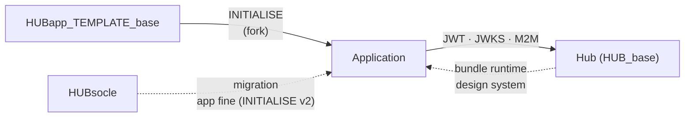

# HUBapp_TEMPLATE


Template d'application avec authentification Hub pour le développement rapide d'applications connectées.

> ⚡ **App fine (2.35.0)** : le template est une application fine construite sur
> l'image socle `poulidor/socle-api` (HUBsocle) — tout le transverse (auth,
> config, database, hub_client, backup, outbox, CRUD démo) vient du socle,
> versionné par `APP_SOCLE_VERSION` dans le `.env` (aligné automatiquement par
> `make sync-env`). Contrat d'extension : `HUBsocle/docs/REFERENCE-APP-FINE.md`.

## 🗺️ Place dans le parc



Chaque application du parc naît de ce template (fork via `INITIALISE.*`), s'enregistre
auprès du [Hub](https://github.com/POULIDOR-Audit-Developpement/HUB_base) et consomme le
design system [HUBCSS](https://github.com/POULIDOR-Audit-Developpement/HUBCSS) servi par
le Hub. Les nouvelles apps naissent « fines » sur le socle versionné
[HUBsocle](https://github.com/POULIDOR-Audit-Developpement/HUBsocle) (INITIALISE v2).

## 📋 Canevas de cahier des charges

Un outil de conception (pur HTML statique) pour décrire le **besoin métier** d'une
nouvelle application **en amont du code**, à remplir en atelier (dev + métier).
Le canevas est **100 % métier** : il ne contient aucune question technique —
l'**agent Jellycode dérive la couche technique** (modèle de données, endpoints,
permissions, écrans) à partir de la spécification produite.

**Usage :**
1. Ouvrir `cahier-des-charges.html` dans un navigateur (double-clic, fonctionne hors-ligne sauf le logigramme Mermaid qui nécessite un CDN).
2. Répondre aux 10 questions métier : à quoi sert l'app, comment ça se passe aujourd'hui, qui sont les utilisateurs, quelles informations sont gérées, que font les utilisateurs, quels écrans/parcours, quelles règles, quel processus (logigramme), avec quels systèmes échanger, quelles exigences & contraintes.
3. **Exporter Markdown** → cahier des charges livrable (à ranger dans le `docs/` de l'app).
4. **Spécification agent (JSON)** → manifest métier structuré destiné à être ingéré par l'agent Jellycode pour scaffolder l'app.
5. Pour reprendre l'édition plus tard : **Exporter JSON**, puis **Importer JSON** à la session suivante.

Aucun backend, aucune persistance locale — l'export est la seule sauvegarde. Thème clair/sombre via le bouton dédié (préférence dans l'URL).

## 🎯 Fonctionnalités

- ✅ **Auto-enregistrement** auprès du Hub au démarrage
- ✅ **Validation JWT** avec clé publique JWKS
- ✅ **Gestion des rôles** : viewer < user < manager < admin
- ✅ **Communication M2M** (Machine-to-Machine) inter-services
- ✅ **Base de données PostgreSQL** avec SQLAlchemy async
- ✅ **Frontend** React pour tester l'authentification
- ✅ **Docker Compose** prêt à l'emploi
- ✅ **Tests automatisés** avec pytest

## 📁 Structure

```
HUBapp_TEMPLATE/
├── INITIALISE.py       # Lanceur visible à la racine (cross-platform)
├── INITIALISE.sh       # Lanceur Linux / macOS
├── INITIALISE.bat      # Lanceur Windows / drag-and-drop
├── backend/
│   ├── main.py           # App fine : create_app() du socle (+ routers métier)
│   ├── migrations/       # Migrations SQL de l'app (001-08x ; socle = 090+)
│   └── tests/            # Tests pytest (app fine + canari 7 tests)
├── frontend/
│   ├── index.html        # Point d'entrée HTML
│   ├── package.json      # Dépendances npm (dont @poulidor/hub-socle)
│   ├── vite.config.js    # Configuration Vite (preserveSymlinks)
│   └── src/              # Code source React
│       ├── App.jsx       # Composant principal
│       ├── config.js     # Configuration frontend
│       ├── components/   # Composants React
│       └── context/      # Contextes (Auth, Config)
├── docker-compose.yml    # Orchestration Docker
├── Dockerfile.backend    # Image API
├── Dockerfile.frontend   # Image Frontend (nginx)
├── nginx.conf            # Config serveur statique
└── .env.example          # Variables d'environnement
```

## 🚀 Démarrage rapide

### 1. Choisir un mode d'initialisation

Le bootstrap prend désormais en charge 3 modes :

- **application client** : import d'une fiche client JSON ou saisie assistée
- **application outil** : configuration guidée d'un outil interne
- **application autre** : saisie manuelle complète

Exemple de fiche client : [docs/client-profile.example.json](docs/client-profile.example.json)

### 2. Lancer l'initialisation

**Méthode recommandée** : utiliser le lanceur visible à la racine.

```bash
# Linux / macOS
bash INITIALISE.sh
bash INITIALISE.sh --clean
bash INITIALISE.sh --tailwind
bash INITIALISE.sh --profile docs/client-profile.example.json

# Windows
INITIALISE.bat
INITIALISE.bat docs\client-profile.example.json

# Cross-platform
python INITIALISE.py
python INITIALISE.py client.json
```

Si votre OS le permet, vous pouvez aussi déposer une fiche client JSON directement
sur `INITIALISE.bat` ou `INITIALISE.py` : le chemin du fichier sera transmis au bootstrap.

Une fois l'init réussie, `INITIALISE.{py,sh,bat}` à la racine et sous `ACTIONS/` s'auto-suppriment, et tous
les scripts d'action (START, STOP, LOGS, STATUS, BACKUP_DB, COMMIT, etc.) sont
générés sous `ACTIONS/PYTHON/`, `ACTIONS/LINUX/`, `ACTIONS/WINDOWS/`.

### 3. Format attendu pour une fiche client JSON

Le format minimal attendu est :

```json
{
  "format_version": "1.0",
  "app": {
    "slug": "mon-client",
    "name": "Mon Client",
    "description": "Application métier HUB"
  },
  "client": {
    "name": "Nom du client"
  },
  "license": {
    "quote_number": "DEVIS-2026-0001",
    "quote_date": "2026-05-10"
  },
  "hub": {
    "host": "192.0.2.11",
    "api_port": 8000,
    "frontend_port": 80
  },
  "ports": {
    "api": 9045,
    "frontend": 4250
  }
}
```

### 4. Lancer l'application

```bash
bash ACTIONS/LINUX/START.sh        # Linux/macOS
ACTIONS\WINDOWS\START.bat          # Windows
```

Pour créer un commit versionné avec changelog alimenté par le message Git :

```bash
# Message fourni par l'IA / l'utilisateur
bash ACTIONS/LINUX/COMMIT.sh -m "feat: add action scripts"

# Ou génération via une commande IA externe recevant le diff staged sur stdin
AI_COMMIT_CMD='votre-commande-ia' bash ACTIONS/LINUX/COMMIT.sh
```

`COMMIT` fait par défaut : `git add -A`, bump `patch`, entrée `CHANGELOG.md`,
synchronisation via `scripts/bump_version.py`, puis `git commit`. Options utiles :
`--minor`, `--major`, `--no-bump`, `--no-stage`, `--no-ai`, `--dry-run`.

> Important: après toute modification de `FRONTEND_PORT` dans `.env`, relancez `make sync-env` pour conserver `FRONTEND_HTTPS_PORT = FRONTEND_PORT + 1`.

### 5. Accès

- **Frontend** : http://localhost:4250
- **API Docs** : http://localhost:9045/api/docs
- **Health** : http://localhost:9045/api/health

## 🛠️ Commandes make

Référence rapide (détail : `make help`) :

| Cible | Rôle |
|---|---|
| `make up` / `make dev` / `make build` | Stack prod / dev avec reload / rebuild images |
| `make down`, `make restart` | Arrêter, redémarrer |
| `make logs`, `make logs-api`, `make logs-db` | Suivre les logs |
| `make test` | Suite pytest **parallèle** (xdist) · `test-seq` : séquentiel (debug flaky) |
| `make test-cov`, `make test-docker` | Couverture · tests sur stack compose isolée |
| `make health`, `make health-detailed` | Health check de l'app |
| `make version`, `make bump-patch/minor/major` | Version (cf. 🏷️ Gestion des versions) |
| `make sync-env`, `make sync-hub-host` | Sync ports/.env · redécouverte `HUB_HOST` |
| `make pull` | Mise à jour git sûre (stash auto → `--ff-only` → stash pop) — manuel, ne build pas |
| `make sync-hub-tooling`, `sync-hub-tooling-check` | Sync serveur MCP (`hub-mcp/`) + vérif diff |
| `make ssl` | Certificats HTTPS locaux |
| `make db-shell` | psql dans le conteneur DB |
| `make verify-ui`, `make lint-classes` | Contrôles UI / classes HUBCSS |
| `make ai-index` | Index de contexte pour l'agent IA |

## Changement d'IP du serveur (Hub + apps sur le même serveur)

Quand le serveur change d'IP, `make sync-env` (donc `make up` / `make dev` / `make build`)
découvre et met à jour `HUB_HOST` automatiquement via l'endpoint `GET /api/config/hub-host`
du Hub. En cas d'échec (Hub arrêté), la valeur courante est conservée silencieusement.

Pour gérer explicitement un changement d'IP :

```bash
make sync-hub-host                       # découverte auto + prompt de secours si Hub injoignable
make sync-hub-host HUB_HOST=192.168.1.200  # force une IP précise (CI/scripts, multi-serveur)
make up                                  # redémarre avec la nouvelle IP
```

**Multi-serveur** (app sur un autre serveur que le Hub) : la découverte inclut toujours l'ancien
`HUB_HOST` comme candidat, donc une app distante reste stable tant que le Hub distant répond.
Si le Hub distant déménage, utilisez `make sync-hub-host HUB_HOST=<nouvelle IP du Hub>`.

## 🔐 Endpoints par rôle

| Endpoint | Rôle minimum | Description |
|----------|--------------|-------------|
| `GET /api/public` | - | Accessible sans authentification |
| `GET /api/protected` | token | Token valide requis |
| `GET /api/viewer-only` | viewer | Lecture seule |
| `GET /api/user-only` | user | Lecture/écriture |
| `GET /api/manager-only` | manager | Gestion |
| `GET /api/admin-only` | admin | Administration |
| `GET /api/service-only` | service | M2M uniquement |

### Endpoints Backup/Restore (admin)

| Endpoint | Méthode | Description |
|----------|---------|-------------|
| `/api/admin/backup/estimate` | GET | Estimer taille et durée du backup |
| `/api/admin/backup` | POST | Créer un backup complet |
| `/api/admin/backup/download` | GET | Télécharger le backup (ZIP) |
| `/api/admin/backup/list` | GET | Lister les backups locaux |
| `/api/admin/backup/{id}` | DELETE | Supprimer un backup local |
| `/api/admin/restore` | POST | Restaurer depuis un fichier |
| `/api/admin/sync-to-hub` | POST | Pousser le backup vers le Hub |
| `/api/admin/sync-from-hub` | POST | Restaurer depuis le Hub |

## 🧪 Tests

```bash
cd backend

# Installer les dépendances de test
pip install -r requirements.txt

# Lancer les tests
pytest

# Avec couverture
pytest --cov=. --cov-report=html
```

## 🏷️ Gestion des versions

Ce template utilise un **système de versionnage automatique** basé sur [Semantic Versioning](https://semver.org/).

### 🚀 Installation (une seule fois)

Après avoir cloné le template, installez les hooks Git pour activer la synchronisation automatique :

```bash
./scripts/install-hooks.sh
```

C'est tout ! Les versions seront maintenant **synchronisées automatiquement** à chaque commit.

### Fonctionnement automatique

1. **À chaque commit** : Un hook Git synchronise automatiquement les versions dans tous les fichiers
2. **Le développeur n'a rien à faire** : Il suffit de modifier le fichier `VERSION` si besoin
3. **Fichiers auto-synchronisés** : `package.json`, `main.py`, `.env.example`, `docs/API.md`

### Changer de version

Pour changer de version, modifiez simplement le fichier `VERSION` :

```bash
# Éditer le fichier VERSION (ex: 1.6.0 -> 1.7.0)
echo "1.7.0" > VERSION

# Au prochain commit, tout sera synchronisé automatiquement !
git add .
git commit -m "feat: nouvelle fonctionnalité"
# -> Les versions sont mises à jour automatiquement
```

### Commandes manuelles (optionnelles)

Si vous préférez utiliser des commandes :

```bash
# Incrémenter automatiquement la version
python3 scripts/bump_version.py patch    # 1.6.0 -> 1.6.1
python3 scripts/bump_version.py minor    # 1.6.0 -> 1.7.0
python3 scripts/bump_version.py major    # 1.6.0 -> 2.0.0

# Vérifier la cohérence
python3 scripts/bump_version.py --check

# Afficher un template de changelog
python3 scripts/bump_version.py --template
```

### Fichiers synchronisés

| Fichier | Élément mis à jour |
|---------|-------------------|
| `VERSION` | Source de vérité |
| `.env.example` | `APP_VERSION` pour les builds Docker |
| `frontend/package.json` | Champ `version` |
| `backend/main.py` | Version FastAPI |
| `docs/API.md` | Badge de version |

### Format du CHANGELOG

Le fichier `CHANGELOG.md` suit le format [Keep a Changelog](https://keepachangelog.com). 
Chaque version doit avoir une entrée avec la structure suivante :

```markdown
## [X.Y.Z] - Date

### ✨ Nouvelles fonctionnalités
- **Nouveau** : Description de la fonctionnalité

### 🐛 Corrections
- **Fix** : Description de la correction

### 📝 Modifications
| Fichier | Modification |
|---------|--------------|
| `fichier.py` | Description du changement |
```

### Endpoint de version

L'API expose un endpoint `/api/version` pour vérifier la version déployée :

```bash
curl http://localhost:9045/api/version
# {"version": "1.6.0", "app": "mon-app", "name": "Mon Application"}
```

## 📝 Personnalisation

### Mettre à jour le Design System (HUBCSS)

Les assets HUBCSS sont **vendored** : committés dans
`frontend/public/design-system/current/` et embarqués dans l'image nginx au
build. La montée de version est un commit reviewable :

1. `make update-ds` — copie les assets depuis le checkout `HUBCSS` du stack
   (`../../HUBCSS`, surcharge `HUBCSS_DIR=...` ou `--from <dir>`), sha256
   vérifiés contre `manifest.json` (version visible dans
   `current/manifest.json`).
2. Relire le `git diff`, puis committer.

Surcharges locales : **uniquement dans `frontend/src/app.css`** — ne jamais
éditer les fichiers de `current/` (ils seraient écrasés à la prochaine mise
à jour, sans être signalés).

### Changer le slug de l'application

1. Modifier `.env` : `APP_SLUG=mon-nouvelle-app`
2. Redémarrer : `docker-compose up -d --build`

### Ajouter un nouveau modèle

1. Créer le modèle métier dans `backend/models.py` (hériter du `Base` du
   socle : `from hub_socle.database import Base`) et le déclarer à
   `create_app(models=[...])` dans `main.py`
2. Ajouter les schémas dans `backend/schemas.py` (app-side)
3. Créer les endpoints dans `backend/routes/` et les passer à
   `create_app(routers=[...])`
4. Déclarer les settings métier via `register_settings_extra(...)` AVANT
   d'importer les routes
5. Ajouter les tests dans `backend/tests/`

> **Contrat app fine complet** (extension models/routes/settings/storage,
> pièges connus, jeu de tests minimal) :
> `HUBsocle/docs/REFERENCE-APP-FINE.md`

### Utiliser la communication M2M

```python
from hub_socle.hub_client import hub_client

# Appeler un autre service
result = await hub_client.call_service(
    service_slug="autre-app",
    endpoint="/api/data",
    method="GET"
)
```

## ⚠️ Points importants

1. **Le Hub doit être démarré avant cette application**
2. **Utiliser des IP** (pas `localhost`) pour les URLs
3. **Ne jamais stocker les credentials M2M** dans des fichiers
4. **Les tokens sont gérés par le Hub** - l'app ne fait que les valider

## 📚 Documentation Hub

Documentation locale utile :

- `docs/REMOTE_APPS.md` : deploiement d'applications distantes ou sur le meme serveur
- `docs/HUB_MESSAGES.md` : integration du systeme de notifications/messages Hub et retrofit sur une ancienne application
- `docs/HTTPS.md` : proxy `/hub/`, HTTPS et SSE
- `docs/BACKUP_RESTORE.md` : backup, restauration et synchronisation Hub

Pour plus d'informations sur l'intégration :
```bash
curl http://192.0.2.11:8000/api/docs/integration
```

## 💾 Système de Backup/Clone

Ce template inclut un système complet de sauvegarde et restauration permettant de cloner intégralement une application.

### Fonctionnalités

- ✅ **Estimation préalable** : Taille et durée estimées avant le backup
- ✅ **Backup complet** : Items, préférences utilisateur, fichiers uploadés
- ✅ **Format ZIP** : `data.json` + dossier `files/` avec tous les fichiers binaires
- ✅ **Synchronisation Hub** : Push/Pull des backups via le Hub central
- ✅ **Restauration sélective** : Choisir quoi restaurer (items, préférences, fichiers)

### Structure du backup

```
backup_{uuid}.zip
├── data.json           # Données structurées (items, préférences, métadonnées fichiers)
└── files/              # Fichiers binaires
    └── {owner}/
        └── {category}/
            └── fichier.pdf
```

### Utilisation

#### 1. Estimer le backup (avant de lancer)

```bash
curl -H "Authorization: Bearer $TOKEN" \
  http://localhost:9045/api/admin/backup/estimate
```

Réponse :
```json
{
  "total_items": 150,
  "total_preferences": 25,
  "total_files": 42,
  "total_size_bytes": 15728640,
  "total_size_human": "15.0 MB",
  "estimated_duration_seconds": 1.5,
  "estimated_duration_human": "2 sec",
  "files_by_category": {"documents": 10485760, "images": 5242880},
  "warning": null
}
```

#### 2. Créer un backup

```bash
curl -X POST -H "Authorization: Bearer $TOKEN" \
  http://localhost:9045/api/admin/backup
```

#### 3. Télécharger le backup

```bash
curl -H "Authorization: Bearer $TOKEN" \
  "http://localhost:9045/api/admin/backup/download?backup_id={id}" \
  -o backup.zip
```

#### 4. Restaurer depuis un fichier

```bash
curl -X POST -H "Authorization: Bearer $TOKEN" \
  -F "file=@backup.zip" \
  -F "clear_existing=false" \
  http://localhost:9045/api/admin/restore
```

#### 5. Synchronisation avec le Hub

```bash
# Pousser vers le Hub
curl -X POST -H "Authorization: Bearer $TOKEN" \
  http://localhost:9045/api/admin/sync-to-hub

# Récupérer depuis le Hub
curl -X POST -H "Authorization: Bearer $TOKEN" \
  -H "Content-Type: application/json" \
  -d '{"clear_existing": false}' \
  http://localhost:9045/api/admin/sync-from-hub
```

### Gestion des fichiers uploadés

Le template inclut un système de stockage de fichiers que les futures applications peuvent utiliser :

#### Modèle `UploadedFile`

```python
# Champs disponibles dans models.py
class UploadedFile(Base):
    filename: str           # Nom du fichier
    original_filename: str  # Nom original uploadé
    relative_path: str      # Chemin dans le storage
    size: int               # Taille en bytes
    mime_type: str          # Type MIME
    hash: str               # SHA-256 pour vérification
    category: str           # Catégorie (documents, images, etc.)
    description: str        # Description optionnelle
    owner: str              # Propriétaire (username)
    entity_type: str        # Type d'entité liée (optionnel)
    entity_id: int          # ID de l'entité liée (optionnel)
```

#### Utilisation du StorageManager

```python
from storage import storage_manager

# Sauvegarder un fichier uploadé
result = await storage_manager.save_file(
    file=upload_file,          # FastAPI UploadFile
    owner="username",
    category="documents"
)

# Lire un fichier
content = await storage_manager.read_file("username/documents/file.pdf")

# Lister les fichiers
files = await storage_manager.list_files(owner="username")

# Statistiques
stats = await storage_manager.get_storage_stats()
```

### Configuration du stockage

```env
# .env
UPLOADS_DIR=/app/uploads  # Répertoire de stockage (volume Docker)
```

### Pour les développeurs d'applications futures

Lors du développement d'une nouvelle application basée sur ce template :

1. **Utilisez `UploadedFile`** pour tracker tous les fichiers uploadés
2. **Associez les fichiers** à vos entités via `entity_type` et `entity_id`
3. **Utilisez `storage_manager`** pour toutes les opérations fichiers
4. **Catégorisez vos fichiers** pour une meilleure organisation
5. **Tout sera inclus automatiquement** dans les backups !

#### Exemple d'association fichier-entité

```python
# Dans votre endpoint d'upload
@app.post("/api/projects/{project_id}/documents")
async def upload_project_document(
    project_id: int,
    file: UploadFile,
    db: AsyncSession = Depends(get_db),
    user: TokenPayload = Depends(get_current_user)
):
    # Sauvegarder le fichier
    result = await storage_manager.save_file(
        file=file,
        owner=user.sub,
        category="project_documents"
    )
    
    # Enregistrer en BDD avec association
    uploaded_file = UploadedFile(
        filename=result["filename"],
        original_filename=result["original_filename"],
        relative_path=result["relative_path"],
        size=result["size"],
        mime_type=result["mime_type"],
        hash=result["hash"],
        category="project_documents",
        owner=user.sub,
        entity_type="project",      # Association au projet
        entity_id=project_id
    )
    db.add(uploaded_file)
    await db.commit()
    
    return {"file_id": uploaded_file.id}
```

### Endpoints Hub requis (côté Hub)

Pour que la synchronisation fonctionne, le Hub doit exposer :

```
POST /api/apps/{app_slug}/backup         # Recevoir un backup
GET  /api/apps/{app_slug}/backup/latest  # Retourner le dernier backup
GET  /api/apps/{app_slug}/backup/{id}    # Retourner un backup spécifique
```
